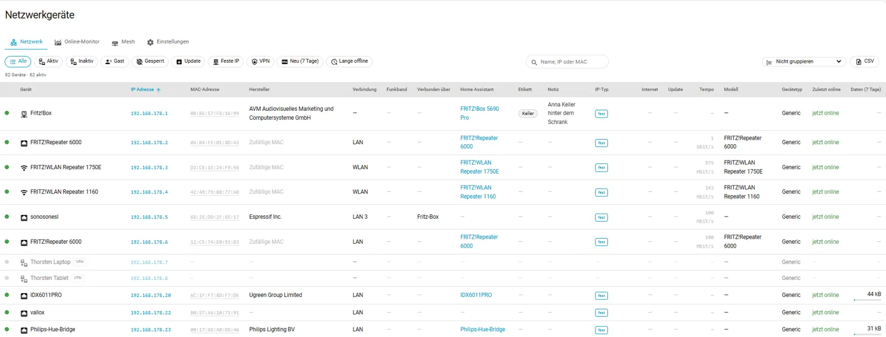
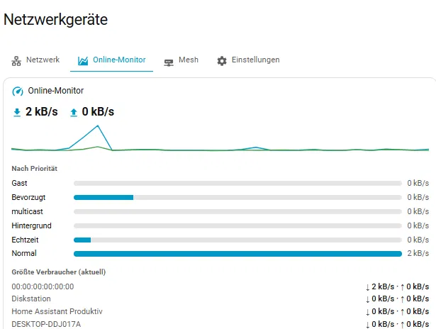
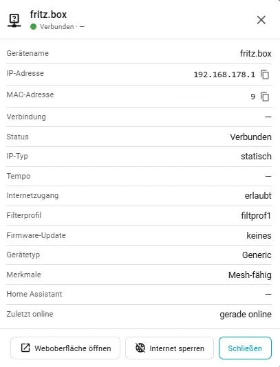
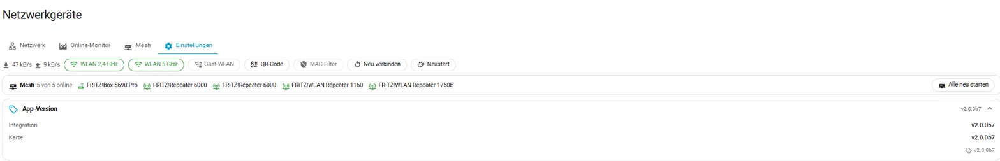

**🌍 Sprache · Language · Taal · Langue · Idioma**

| 🇩🇪 [Deutsch](README.md) | 🇬🇧 [English](README.en.md) | 🇳🇱 [Nederlands](README.nl.md) | 🇫🇷 **Français** | 🇪🇸 [Español](README.es.md) |
|:---:|:---:|:---:|:---:|:---:|

# FRITZ!Box Netzwerk

Une intégration Home Assistant qui affiche tous les appareils du réseau domestique FRITZ!Box sur votre tableau de bord sous forme de tableau triable – avec adresse IP, adresse MAC, type de connexion et nom de l'appareil Home Assistant correspondant.


📺 **Vidéo et guide de la carte réseau (en allemand) :** [meinesmartewelt.de – FRITZ!Box Netzwerk pour Home Assistant](https://meinesmartewelt.de/fritzbox-netzwerk-home-assistant/)

> Ceci est l'édition française du README, disponible en cinq langues (voir la barre de langues ci-dessus). Le [README.md](README.md) allemand est le fichier principal : il contient la référence complète de la carte, le chapitre de dépannage et l'historique complet des versions. Les sections marquées « en allemand uniquement » ne sont pas encore traduites. L'intégration et la carte elles-mêmes sont traduites en allemand, anglais et néerlandais.

---

## Sommaire

- [Captures d'écran](#captures-décran)
- [Fonctionnalités](#fonctionnalités)
- [Prérequis](#prérequis)
- [Installation](#installation)
- [Configuration](#configuration)
- [Paramètres](#paramètres)
- [Capteurs](#capteurs)
- [Événements](#événements)
- [Mesh et répéteurs](#mesh-et-répéteurs)
- [Filtre MAC et appairage](#filtre-mac-et-appairage)
- [Contrôle parental : profils d'accès (expérimental)](#contrôle-parental--profils-daccès-expérimental)
- [CPU et RAM de la box (expérimental)](#cpu-et-ram-de-la-box-expérimental)
- [Paramètres DNS (expérimental)](#paramètres-dns-expérimental)
- [Adresse IP statique (expérimental)](#adresse-ip-statique-expérimental)
- [Centre de notifications (facultatif)](#centre-de-notifications-facultatif)
- [La carte du tableau de bord](#la-carte-du-tableau-de-bord)
- [Services](#services)
- [Blueprints](#blueprints)
- [Affichage de la version et avis de mise à jour](#affichage-de-la-version-et-avis-de-mise-à-jour)
- [Langues](#langues)
- [Sécurité](#sécurité)
- [Limites connues](#limites-connues)
- [Dépannage](#dépannage)
- [Intégrité des fichiers](#intégrité-des-fichiers)
- [Développement et tests](#développement-et-tests)
- [Historique des versions](#historique-des-versions)
- [Licence](#licence)

---

## Captures d'écran

<p align="center"></p>

**Onglet « Réseau »** – tous les appareils dans un tableau triable avec barre de filtres (Actif, Inactif, Invité, Bloqué, Mise à jour, IP fixe, VPN, Nouveau, Hors ligne depuis longtemps), adresses IP et MAC, fabricant, connexion, lien vers l'appareil Home Assistant, étiquette et note.



**Onglet « Moniteur en ligne »** – débit actuel en téléchargement et en envoi avec historique, charge par priorité et plus gros consommateurs. Toucher un consommateur ouvre la fenêtre de l'appareil.



**Fenêtre de détails** – ici pour la FRITZ!Box : nom, adresses IP et MAC, état, type d'IP, accès à Internet, profil de filtre, mise à jour du firmware, caractéristiques et dernière connexion, avec les boutons *Ouvrir l'interface web* et *Bloquer Internet*.



**Onglet « Paramètres »** – interrupteurs Wi-Fi, code QR, filtre MAC, reconnexion, redémarrage, groupe mesh avec compteur en ligne et sections dépliables (version de l'app, FRITZ!Box avec température, connexion Internet, réseau domestique).



Plus de détails dans la vidéo et le guide (en allemand) : [meinesmartewelt.de – FRITZ!Box Netzwerk pour Home Assistant](https://meinesmartewelt.de/fritzbox-netzwerk-home-assistant/).

---

## Fonctionnalités

- Tous les appareils réseau connus de la FRITZ!Box dans **un seul** tableau sur le tableau de bord
- **Triable** en cliquant sur n'importe quel en-tête de colonne, également au clavier ; **recherche** sur le nom, l'IP, la MAC, le modèle et le nom Home Assistant
- **Barre de filtres** : Tous, Actifs, Inactifs, Invités, Bloqués, Mise à jour, IP fixe, VPN – chaque bouton peut être masqué individuellement
- **Bande Wi-Fi** (2,4 / 5 GHz), **fabricant d'après l'adresse MAC** (liste fournie, sans accès Internet), **copie de la MAC en un clic**
- **Filtre IP avec jokers** (`192.168.2.*`) pour répartir un grand réseau sur plusieurs cartes
- **Fenêtre de détails** par appareil avec tous les champs, Wake-on-LAN, renommage, étiquette/note/marqueur « réservé » et accès à l'appareil Home Assistant
- **Dernière présence**, **interrupteur d'accès à Internet** (expérimental), **type d'IP** (fixe ou dynamique)
- **Capteurs de connexion** (débit montant/descendant, débits de synchronisation de la ligne, IP externe, durée de connexion, état de la connexion) et **événements** (« nouvel appareil », « IP externe modifiée »)
- **Groupe Mesh** : FRITZ!Box et répéteurs comme une seule unité, bouton « Redémarrer tous les appareils FRITZ! »
- **Filtre MAC Wi-Fi** activé/désactivé et libération temporaire (« appairage »)
- **Contrôle parental** (expérimental) : changer le profil d'accès par appareil, aussi temporairement
- **Paramètres DNS** de la box (expérimental, depuis 1.8.0) : lecture et modification
- **Adresse IP statique** par appareil (expérimental, depuis 1.8.0) : attribution avec vérification des doublons, bouton dans la fenêtre de détails ; le chemin d'écriture a été revu en 2.0.0 (interface REST, relecture de contrôle)
- **Réservations de la box** (depuis 2.0.0, non testé sur une box) : les appareils avec « Toujours attribuer la même adresse IPv4 à cet appareil réseau » sont lus depuis la box et comptés comme fixes
- **Appareils VPN** (depuis 2.0.0, non testé sur une box) : les pairs que la box signale avec l'indicateur VPN mais sans adresse MAC (par ex. WireGuard) ne disparaissent plus de la liste ; le bouton de filtre **VPN** (`filter_vpn: false` le masque) n'affiche que ces appareils
- **Affichage de la version et avis de mise à jour** sur la page de commande de la carte
- Entièrement configurable via l'interface, y compris des **couleurs libres**, trois langues (de, en, nl)

La carte est fournie avec l'intégration et enregistrée automatiquement comme ressource Lovelace.

---

## Prérequis

- Home Assistant 2024.11 ou plus récent
- Une FRITZ!Box avec **« Autoriser l'accès pour les applications »** activé (Réseau domestique → Réseau → Paramètres réseau)
- Un utilisateur FRITZ!Box avec le droit **« Paramètres de la FRITZ!Box »**

---

## Installation

### Via HACS (recommandé)

1. HACS → Intégrations → menu en haut à droite → **Dépôts personnalisés**
2. Ajouter `https://github.com/Meine-smarte-Welt/fritzbox_netzwerk` dans la catégorie *Intégration*
3. Installer « FRITZ!Box Netzwerk »
4. Redémarrer Home Assistant

**Préversions (bêta, release candidate) :** HACS ne les affiche que si vous activez **« Afficher les versions bêta »** lors du téléchargement. Avec une bêta installée, l'affichage de la version dans la carte signale aussi les bêtas plus récentes.

### Manuellement

Copier le dossier `custom_components/fritzbox_netzwerk` dans le répertoire `config` de Home Assistant, puis redémarrer.

---

## Configuration

Paramètres → Appareils et services → **Ajouter une intégration** → « FRITZ!Box Netzwerk ».

| Champ | Signification |
| --- | --- |
| Adresse | Nom d'hôte ou adresse IP, en général `fritz.box` |
| Nom d'utilisateur | Utilisateur FRITZ!Box avec le droit « Paramètres de la FRITZ!Box » |
| Mot de passe | Le mot de passe correspondant |
| Connexion chiffrée | HTTPS au lieu de HTTP vers la FRITZ!Box |
| Port | `0` utilise les ports par défaut ; ou saisir le vôtre |
| Accès à distance via MyFRITZ!/HTTPS | Utilise HTTPS et le préfixe de chemin TR-064 `/tr064` |

Les identifiants sont vérifiés immédiatement (joignable, connexion valide, service des hôtes utilisable). En cas d'échec, la boîte de dialogue indique la cause précise.

Pour l'accès à distance, saisissez l'adresse MyFRITZ! ou DynDNS **sans protocole, port ni chemin**, indiquez le port HTTPS séparément et activez « Accès à distance via MyFRITZ!/HTTPS ». **Attention :** `fritzconnection` ne vérifie pas le certificat TLS ; sur l'Internet ouvert, un VPN vers votre propre FRITZ!Box est le choix le plus sûr (détails dans le README allemand).

---

## Paramètres

Via *Configurer* sur l'intégration :

| Paramètre | Valeur par défaut | Signification |
| --- | --- | --- |
| Intervalle d'interrogation | 60 s | Fréquence de récupération de la liste des appareils (30–3600 s) |
| Enregistrer le type d'IP | activé | Détermine si l'adresse est DHCP/statique |
| Intervalle du type d'IP | 15 min | Cycle de collecte du type d'IP |
| Enregistrer la bande Wi-Fi par appareil | activé | Lit les appareils connectés par réseau Wi-Fi pour que la carte affiche la bande |
| Créer des suivis d'appareils | désactivé | Un `device_tracker` par appareil réseau |
| Créer les répéteurs comme appareils distincts | activé | Un appareil Home Assistant par répéteur AVM, capteur mesh, bouton « tout redémarrer » |
| Commande de la FRITZ!Box (expérimental) | désactivé | Interrupteur Wi-Fi, interrupteur du filtre MAC, bouton d'appairage, boutons de reconnexion/redémarrage |
| Service Wi-Fi invité (depuis 1.9.1) | Automatique | Numéro (1–4) du service Wi-Fi de la box qui est le réseau invité. « Automatique » le détecte lui-même ; ne le modifier que si l'interrupteur invité ou le code QR montre le mauvais réseau |
| Vérifier chaque jour une nouvelle version | activé | Interroge GitHub une fois par jour pour la dernière version ; aucune donnée sur vous ou la box n'est envoyée |
| Commander les profils d'accès du contrôle parental (expérimental) | désactivé | Active les services et le choix du profil dans la fenêtre de détails |
| Modifier les paramètres DNS de la box (expérimental) | désactivé | Autorise `set_dns_settings` à écrire ; la lecture et l'aperçu fonctionnent toujours |
| Définir l'adresse IP statique (expérimental) | désactivé | Autorise `set_static_ip` et le bouton de la carte à écrire ; l'aperçu (`dry_run`) fonctionne toujours |
| Lire le CPU et la RAM de la box (expérimental) | désactivé | Trois capteurs issus de l'interface web de la box |
| Créer des appareils réseau comme appareils distincts | désactivé | Un appareil HA par appareil sélectionné, choisi par motif |
| Envoyer des messages au centre de notifications (depuis 2.0.0) | activé | Interrupteur principal de la liaison facultative, voir [Centre de notifications](#centre-de-notifications-facultatif) |
| Types de messages à envoyer (depuis 2.0.0) | tous | Quels types de messages vont au centre de notifications (connexion perdue, appareil surveillé hors ligne, nouvel appareil) |
| Durée d'appairage | 5 min | Durée pendant laquelle le filtre MAC reste désactivé lors de l'appairage (1–120 min) |

---

## Capteurs

| Capteur | État | Utilité |
| --- | --- | --- |
| `sensor.<name>_gerate` | Nombre d'appareils connectés | Porte la liste complète des appareils dans l'attribut `hosts` ; source de données de la carte |
| `sensor.<name>_gerate_mit_update` | Nombre | Automatisation « nouveau firmware disponible » |
| `sensor.<name>_gesperrte_gerate` | Nombre | Surveillance du contrôle parental |
| `sensor.<name>_download` / `_upload` | kB/s | Débit de transfert actuel |
| `sensor.<name>_mesh` | Nombre en ligne | Appareils FRITZ! joignables (box + répéteurs) ; uniquement avec des répéteurs |
| `sensor.<name>_download_leitungsrate` / `_upload_leitungsrate` | Mbit/s | Débit de synchronisation maximal de la ligne |
| `sensor.<name>_externe_ip` | Adresse IPv4 | IP publique actuelle |
| `sensor.<name>_online_seit` | Horodatage | Depuis quand la connexion est établie |
| `binary_sensor.<name>_internet_verbunden` | Connecté/Non connecté | La box est-elle en ligne ? |

Si le service WAN est absent (par ex. la box fonctionne uniquement comme point d'accès), ces capteurs restent « inconnu » sans affecter la liste des appareils. L'attribut `hosts` est exclu de l'enregistreur (recorder).

## Événements

Depuis 1.6.2 : « nouvel appareil » à sa première apparition dans le réseau domestique et « IP externe modifiée », utilisables dans des automatisations sans appel TR-064 supplémentaire.

---

## Mesh et répéteurs

La FRITZ!Box et ses répéteurs AVM forment le mesh. L'intégration les traite comme **un seul groupe** : les répéteurs apparaissent comme des appareils distincts sous la box, il y a un compteur en ligne et le bouton « Redémarrer tous les appareils FRITZ! » (répéteurs d'abord, box en dernier). Depuis 1.6.3, la carte indique dans « Connecté via » à quel voisin mesh un appareil est rattaché, avec le débit de la liaison. Pas de puissance du signal en dBm (la liste mesh ne la fournit pas). Depuis 1.9.0, un appareil est aussi traité comme répéteur si la topologie mesh de la box le liste comme membre du mesh, la bande Wi-Fi des appareils derrière un répéteur est lue d'après le nom de l'interface mesh (deux hypothèses non testées sur du matériel réel), les répéteurs qui n'ont qu'un mot de passe (sans nom d'utilisateur) sont retentés avec un nom d'utilisateur vide, et la liste peut être regroupée par connexion mesh (`group_by: mesh`). Détails : README allemand.

## Filtre MAC et appairage

Avec *Commande de la FRITZ!Box* activée, vous obtenez `switch.<name>_mac_filter` (activé/désactivé en permanence) et `button.<name>_pairing_starten` (désactive le filtre pour la durée définie, puis le **réactive automatiquement**). Les services `set_mac_filter` et `start_pairing` font de même depuis des automatisations. Expérimental.

## Contrôle parental : profils d'accès (expérimental)

L'intégration **bascule entre des profils d'accès existants** (Internet → Filtres → Profils d'accès) ; vous les créez et les modifiez toujours dans la FRITZ!Box. Activez l'option, puis utilisez la ligne **Profil d'accès** dans la fenêtre de détails ou les services `list_access_profiles`, `get_access_profile`, `set_access_profile`. Avec un nombre de minutes, le profil ne s'applique que pendant ce temps, puis le précédent est rétabli. La ligne peut être masquée avec `show_parental: false`. Utilise l'interface web non documentée, pas TR-064.

## CPU et RAM de la box (expérimental)

L'option « Lire le CPU et la RAM de la box (expérimental) » (désactivée par défaut) crée trois capteurs : charge CPU, charge RAM, température du CPU. Ils proviennent de la page `ecoStat` de l'interface web, pas de TR-064 ; non vérifié sur une box – comparer avec Système → Suivi énergétique.

Les valeurs – y compris la **température** – apparaissent aussi dans la carte, onglet *Paramètres*, dans la section dépliable *FRITZ!Box*. Si l'option est désactivée, une indication s'y affiche à la place des valeurs.

---

## Consommation de données par appareil (expérimental)

Option « Enregistrer la consommation de données (expérimental) » (désactivée par défaut). Elle indique **quel appareil a transféré combien de données au cours de la dernière semaine**, afin de repérer les appareils qui communiquent trop avec Internet ou saturent le Wi-Fi (demande issue de #26).

**Fonctionnement :** TR-064 ne fournit aucun chiffre de consommation par appareil. L'intégration lit donc le **moniteur en ligne** de la box (interface web, API REST non documentée `api/v0/monitor/…`), qui fournit un **débit** par appareil, et l'intègre dans le temps en totaux journaliers et sur 7 jours (téléchargement et envoi séparés). Les valeurs sont des **estimations**, pas des compteurs de la box.

**Conditions et limites :**
- Dans la FRITZ!Box, **« Enregistrer les débits Internet »** doit être activé pour chaque appareil (Réseau domestique → Réseau → appareil → détails ; « Appareils individuels » dans le moniteur en ligne, FRITZ!OS 7.90/8.0 ou plus récent). Les appareils sans ce réglage n'apparaissent pas.
- Le comptage commence à l'activation de l'option ; la box ne fournit pas de valeurs passées. Une semaine complète demande 7 jours.
- Les totaux sont conservés dans le stockage de Home Assistant (8 jours). Si Home Assistant ou l'interrogation est interrompu un moment, ce temps manque dans les totaux (le diagnostic compte les lacunes sous `traffic.stats`).
- **Unité vérifiée seulement pour la plausibilité :** octets par seconde ; sur une FRITZ!Box 5690 Pro (FRITZ!OS 8.40) l'ordre de grandeur correspond aux compteurs de la box, une comparaison exacte manque encore. Si les chiffres semblent faux, réglez « Unité des valeurs du moniteur en ligne » sur bits par seconde dans les options. Le diagnostic montre des valeurs brutes sous `traffic.shape.sample_values` pour comparer avec le moniteur en ligne de la box.

**Capteurs :** L'option crée *Statut de la consommation de données* (diagnostic ; affiche « Données disponibles », « En attente de mesures », « Aucune source associée », « Aucune mesure correspondante » ou « Erreur de lecture » ; la cause est dans les attributs), *Consommation de données 7 jours (tous les appareils)* et *Plus gros consommateur (7 jours)* (nom de l'appareil, classement des cinq premiers dans les attributs). Chaque appareil avec des valeurs reçoit aussi *<appareil> Daten 7 Tage* et *<appareil> Daten heute* (unité octet, affichage en Go ; téléchargement, envoi et évolution quotidienne en attributs). Les capteurs d'appareil n'apparaissent qu'une fois des valeurs disponibles. **Si vous ne voyez rien, regardez d'abord le capteur de statut.**

**Dans la carte :** colonne **Données (7 jours)** avec barre (un clic sur l'en-tête trie par plus gros consommateur) ; la fenêtre détaillée affiche « Données (7 jours) » avec téléchargement/envoi, « Données aujourd'hui » et une évolution quotidienne. La colonne n'apparaît que si des valeurs existent ; masquer avec `show_traffic: false`. L'export CSV contient la valeur sur 7 jours en octets.

---

## Paramètres DNS (expérimental)

Depuis 1.8.0, l'intégration lit les paramètres DNS de la FRITZ!Box et peut – uniquement après activation de l'option – les modifier.

| Emplacement dans la FRITZ!Box | Champ du service |
| --- | --- |
| Internet → Informations du compte → Serveur DNS (IPv4) | `internet_ipv4_custom`, `internet_ipv4_dns1`, `internet_ipv4_dns2` |
| Internet → Informations du compte → Serveur DNS (IPv6) | `internet_ipv6_custom`, `internet_ipv6_dns1`, `internet_ipv6_dns2` |
| Réseau domestique → Réseau → Paramètres réseau → Avancé → IPv4 | `home_ipv4_dns` |
| Réseau domestique → Réseau → Paramètres réseau → Avancé → IPv6 | `home_ipv6_dns`, `home_ipv6_advertise` |

- `fritzbox_netzwerk.get_dns_settings` ne fait que lire et renvoie les valeurs en réponse.
- `fritzbox_netzwerk.set_dns_settings` ne modifie que les champs que vous transmettez. Les adresses sont validées, la box est lue d'abord, vérifiée après l'écriture et l'état précédent est rétabli en cas d'écart. Si la box demande une confirmation à deux facteurs, rien n'est modifié.
- `dry_run: true` montre ce qui changerait et fonctionne sans l'option.

**État des tests (en toute honnêteté) :** la structure des réponses `dnscfg` et `ipv6`, la connexion et le format d'écriture n'ont été que **lus** sur une FRITZ!Box 5690 Pro. **L'écriture n'est testée sur aucune box réelle.** L'interface REST (`/api/v0/generic/…`) n'est pas documentée par AVM, ce n'est pas TR-064, et elle peut changer avec FRITZ!OS. De mauvais serveurs DNS peuvent perturber la résolution de noms dans tout le réseau domestique – notez d'abord les valeurs.

## Adresse IP statique (expérimental)

Depuis 1.8.0, l'intégration peut attribuer une adresse IPv4 fixe à un appareil – cela correspond, dans la FRITZ!Box, à *Réseau domestique → Réseau → modifier l'appareil → « Toujours attribuer la même adresse IPv4 à cet appareil réseau »*. Activez l'option « Définir l'adresse IP statique (expérimental) ».

- **Service :** `fritzbox_netzwerk.set_static_ip` avec `mac`, `ip` et `dry_run: true` facultatif (aperçu, fonctionne sans l'option).
- **Bouton dans la carte :** dans la fenêtre de détails, la ligne « IP statique » → *Définir* → saisir l'adresse → *Vérifier* (vérification seule) ou *Appliquer*. Peut être masqué avec `show_static_ip: false`.
- **Pas d'adresses en double :** la demande est refusée si l'adresse appartient à un autre appareil actif, fixe ou marqué « réservé », si c'est celle de la box, si elle est en dehors du réseau domestique, si c'est une adresse de réseau/diffusion ou si ce n'est pas une adresse d'appareil valide. Un appareil hors ligne avec la même adresse et une adresse dans la plage DHCP ne produisent qu'un avertissement.
- **Redémarrage nécessaire :** la nouvelle adresse ne s'applique qu'après le redémarrage de l'appareil ou sa reconnexion au réseau.
- **Filet de sécurité :** après l'écriture, l'état est relu (`query.lua`, sinon REST ou `edit_device`). Si l'attribution n'est pas active ensuite, le service signale une erreur et – si elle était active avant – rétablit l'état précédent. Un simple HTTP 200 ne compte pas comme un succès. Si l'état ne peut pas être relu, la réponse indique `verified: false` avec une remarque.
- **Confirmation à deux facteurs :** si la box demande une confirmation, rien n'est modifié. Un utilisateur avec la confirmation supplémentaire activée peut amener la box à rejeter les modifications sans aucun message – utilisez pour l'intégration un utilisateur sans cette confirmation.

**Méthode d'écriture (depuis 2.0.0) :** via l'interface REST de l'interface web, telle qu'un projet tiers la décrit pour FRITZ!OS 8.25 (`jvejmelka/fritzbox-static-lease`) : `PUT /api/v0/generic/landevice/landevice/<UID>` avec `{"static_dhcp": "1"}`, l'adresse souhaitée s'ajoute en tant que `"ip"`. Jusqu'à 1.9.x, l'intégration utilisait des champs de formulaire de `data.lua` qui n'étaient que *supposés* et que la box n'acceptait pas – la modification de l'adresse ne fonctionnait pas. L'ancien chemin n'est plus qu'une solution de repli si la box répond à la requête REST par une erreur HTTP (FRITZ!OS plus ancien).

**État des tests (en toute honnêteté) :** la vérification des doublons et tout le déroulement de l'écriture sont couverts par des tests contre une box **simulée**. **Non** testé sur une FRITZ!Box réelle : le champ `ip` de la requête REST n'est pas testé, même dans le projet tiers, et les noms de champs de la solution de repli sont supposés. De nombreuses box continuent d'indiquer l'ancienne adresse jusqu'à ce que l'appareil se reconnecte – le service le signale alors. Si cela échoue sur votre box, ouvrez un ticket avec le texte de l'erreur et le téléchargement des diagnostics.

---

## Centre de notifications (facultatif)

L'intégration peut envoyer des messages au **centre de notifications** – une intégration « Meine smarte Welt » distincte, elle aussi facultative, qui collecte, trie et distribue les messages. **Sans centre de notifications installé, il ne se passe rien :** pas d'erreur, pas d'entrée de journal supplémentaire, pas de requête supplémentaire vers la FRITZ!Box.

Elle communique via le bus d'événements de Home Assistant (pas de MQTT, pas de broker). Les textes sont envoyés une seule fois, à l'enregistrement, en cinq langues (de, en, nl, fr, es) ; le centre de notifications choisit la langue d'affichage. Au démarrage, seul l'**état initial** est signalé (visible, sans notification push), ensuite uniquement les changements d'état – sans répétitions.

| Type de message | Urgence | Se déclenche quand … | Se ferme |
| --- | --- | --- | --- |
| Connexion à la FRITZ!Box perdue | Avertissement | une requête vers la box échoue (les entités passent en même temps à « indisponible ») | à la requête réussie suivante |
| Appareil surveillé hors ligne | Info | un appareil surveillé n'est plus actif dans la liste des appareils | quand il est de nouveau actif |
| Nouvel appareil sur le réseau | Info | un appareil apparaît pour la première fois dans le réseau domestique (même déclencheur que l'entité d'événement « Nouvel appareil ») | message unique, reste jusqu'à acquittement dans le centre de notifications |

**Sont surveillés** exactement les appareils auxquels l'intégration donne déjà un état « connecté » : les répéteurs (paramètre « Créer les répéteurs comme appareils distincts ») et les appareils réseau choisis par motif d'IP (paramètre « Créer des appareils réseau comme appareils distincts »). Tous les autres appareils ne signalent que « Nouvel appareil ».

**Paramètres** sous *Configurer* : un interrupteur principal « Envoyer des messages au centre de notifications » et un choix des « Types de messages à envoyer » (triés par urgence). Désactivé signifie que rien n'est envoyé, et le centre de notifications ferme les messages déjà ouverts de ce type. Une modification recharge l'intégration comme tout autre paramètre. Les interrupteurs n'existent **que dans cette boîte de dialogue**, pas dans la carte du tableau de bord.

**Contenu des messages :** le nom de l'appareil (pour « Nouvel appareil » aussi l'adresse IP), rien d'autre – ni identifiants, ni détails sur le fabricant ou la connexion. L'adresse MAC sert d'identifiant technique pour pouvoir fermer un message plus tard ; elle figure dans l'événement, pas dans le texte du message. Ni les noms ni les adresses n'apparaissent dans le journal ou le téléchargement des diagnostics ; ce dernier ne liste que l'état des interrupteurs et le nombre de messages par type envoyés depuis le démarrage.

**Limites :**

- Il n'y a volontairement **aucun délai propre** et aucun nouveau seuil : si la box signale un appareil surveillé comme inactif lors d'une interrogation, le message apparaît et se ferme à l'interrogation suivante où il est actif. Si c'est trop bruyant, désactivez le type de message « Appareil surveillé hors ligne ».
- « Nouvel appareil » signale un appareil apparu pendant que Home Assistant était éteint comme un état initial après le démarrage (visible, sans push). Juste après la configuration, il ne signale rien – comme l'entité d'événement.
- Si la connexion échoue à répétition et que Home Assistant demande une nouvelle authentification, ce n'est pas un message « connexion perdue » ; Home Assistant affiche pour cela son propre avis.
- **État des tests :** vérifié uniquement contre un bus d'événements **simulé** (pont et déclencheurs, 44 tests). **Pas** contre un vrai centre de notifications, ni sur une FRITZ!Box réelle ou dans un Home Assistant en fonctionnement. Retours vivement souhaités.

---

## La carte du tableau de bord

La carte est fournie avec l'intégration (`custom:fritzbox-netzwerk-card`). Elle dispose d'un éditeur graphique ; chaque colonne, filtre, la barre de commande et les lignes de la fenêtre de détails peuvent être activés ou désactivés individuellement, les couleurs sont libres, trois langues. La référence complète (colonnes, tri, filtre IP, onglets, regroupement, export CSV, code QR du Wi-Fi invité, balayage sur téléphone, couleurs) se trouve dans le README allemand.

**Onglets (facultatif) :** avec *Afficher les catégories en onglets*, la carte reçoit une barre d'onglets. **Réseau** contient le tableau des appareils. **Moniteur en ligne** montre le débit actuel, la charge par priorité, les détails de connexion et les compteurs en ligne ; touchez un gros consommateur pour ouvrir la fenêtre de cet appareil. **Mesh** dessine la FRITZ!Box, les répéteurs et leurs appareils : touchez la box ou un répéteur pour ouvrir sa fenêtre, touchez « N appareils » pour déplier la liste des appareils du nœud, puis un appareil pour sa fenêtre. **Paramètres** (toujours le dernier onglet) contient les interrupteurs et les sections dépliables *Version de l'app*, *FRITZ!Box* (modèle, FRITZ!OS, adresse IP, durée de fonctionnement, plus température, CPU et RAM avec l'option « Lire CPU et RAM de la box »), *Connexion Internet* et *Réseau domestique*. Vidéo et guide (en allemand) : [meinesmartewelt.de](https://meinesmartewelt.de/fritzbox-netzwerk-home-assistant/).

```yaml
type: custom:fritzbox-netzwerk-card
entity: sensor.fritz_box_5690_pro_netzwerk_gerate
title: Réseau domestique
show_title: true
show_status: true
show_name: true
show_ip: true
show_mac: true
show_connection: true
show_ha_name: true
show_ip_type: true
show_vendor: false
show_band: false
show_summary: true
show_search: true
show_filter: true
default_filter: aktiv   # alle | aktiv | inaktiv | gast | gesperrt | update | fest | vpn
ip_filter: ""           # par ex. "192.168.2.*"
show_parental: true     # ligne du profil d'accès dans la fenêtre de détails
show_static_ip: true    # ligne IP statique dans la fenêtre de détails
sort_by: ip
sort_dir: asc
```

---

## Services

Si plusieurs box sont configurées, tous les services acceptent un champ facultatif `config_entry` qui sélectionne la box.

| Service | Utilité |
| --- | --- |
| `set_device_name` | Renommer un appareil dans la box |
| `wake_on_lan` | Réveiller un appareil |
| `set_internet_access` (expérimental) | Bloquer/autoriser l'accès Internet d'un appareil |
| `set_mac_filter`, `start_pairing` (expérimental) | Filtre MAC Wi-Fi et appairage temporaire |
| `reboot_mesh` (expérimental) | Redémarrer les répéteurs et la box |
| `gast_wlan_info` | Données du Wi-Fi invité (pour le code QR) ; depuis 1.9.0 le service invité est détecté et un `service` facultatif (1-4) peut l'imposer ; depuis 1.9.1 la carte transmet le numéro connu et le paramètre « Service Wi-Fi invité » peut le fixer |
| `set_device_note` | Étiquette, note et marqueur « réservé » (enregistrés uniquement dans Home Assistant) |
| `mark_devices_reserved` | Marquer plusieurs appareils comme « réservés » par motif d'IP (enregistré uniquement dans Home Assistant ; `dry_run` en aperçu) |
| `list_access_profiles`, `get_access_profile`, `set_access_profile` (expérimental) | Profils du contrôle parental |
| `get_dns_settings`, `set_dns_settings` (expérimental) | Paramètres DNS de la box |
| `set_static_ip` (expérimental) | Adresse IPv4 fixe pour un appareil |
| `install_blueprints`, `update_oui` | Installer les blueprints, mettre à jour la liste des fabricants |

## Blueprints

L'intégration fournit des blueprints et un script ; le bouton « Installer les blueprints » les copie dans votre configuration Home Assistant. Détails : README allemand.

---

## Affichage de la version et avis de mise à jour

La version installée est affichée dans la carte (onglet engrenage → version de l'application), dans l'éditeur de la carte et dans la boîte de dialogue des options. Si une version plus récente existe sur GitHub (vérifiée une fois par jour), elle est mise en évidence en orange avec un lien vers les notes de version.

## Langues

Allemand, anglais et néerlandais – dans le config flow, les entités, les services et la carte (langue issue de Home Assistant, repli sur l'anglais). Le **README** est disponible en cinq langues : allemand, anglais, néerlandais, français et espagnol (barre de langues en haut de chaque fichier).

## Sécurité

Les actions d'écriture exigent des droits d'administrateur ; les saisies sont validées côté serveur ; les textes de la carte sont échappés. Les options des fonctions d'écriture expérimentales sont **désactivées par défaut**, et les actions risquées disposent si possible de modes d'aperçu (`dry_run`).

---

## Limites connues

- **« Supprimer toutes les connexions inutilisées » est absent** – TR-064 n'a pas d'action pour cela.
- **Centre de notifications (depuis 2.0.0)** n'est testé que contre un bus d'événements simulé, pas contre un vrai centre de notifications ni du matériel réel ; les interrupteurs n'existent que dans la boîte de dialogue Configurer, pas dans la carte, voir [Centre de notifications](#centre-de-notifications-facultatif).
- **L'IP statique et l'écriture DNS sont expérimentales** et utilisent l'interface web non documentée de la box. L'écriture n'est vérifiée sur aucune box réelle ; la route REST pour l'IP statique suit la description d'un projet tiers pour FRITZ!OS 8.25. Elles peuvent cesser de fonctionner à chaque mise à jour de FRITZ!OS.
- **Réservations DHCP reconnues seulement en partie.** La box ne signale pas via TR-064 les réservations *à l'intérieur* de la plage DHCP. Depuis 2.0.0, l'intégration les lit en plus depuis l'interface web (même cycle que le type d'IP, `query.lua`, sinon `netDev`) ; que votre FRITZ!OS fournisse l'indicateur n'est pas testé. Sinon, ces appareils restent affichés comme « dynamiques » – le téléchargement des diagnostics (`reservations`) indique quelle voie a fonctionné. Vous pouvez aussi les marquer à la main ou en masse (`mark_devices_reserved`).
- **Mesh seulement en partie :** pas de puissance du signal en dBm.
- **Le volume de données par appareil** n'est pas fourni par la box via TR-064.
- **Appareils VPN (ticket #29) :** les entrées sans adresse MAC étaient auparavant écartées comme périmées ; les pairs que la box marque comme VPN (indicateur `X_AVM-DE_VPN` ou type d'interface VPN/WireGuard/IPsec) et qui ont une adresse IP sont désormais conservés, avec l'identifiant `VPN:<IP>`. Ils apparaissent dans la liste et les compteurs mais n'ont pas d'entités ni d'actions nécessitant une adresse MAC (réveil, blocage, renommage, IP statique). **Que la box liste ainsi les pairs WireGuard n'est pas testé** ; il n'existe aucune interface documentée pour les interroger séparément. Le téléchargement des diagnostics (`box_hosts.without_mac_samples`) montre comment la box marque ces entrées.
- Les appareils ne sont associés aux appareils Home Assistant que par l'adresse MAC.
- La liste complète figure dans le README allemand.

## Dépannage

En allemand uniquement : voir le chapitre « Fehlerbehebung » dans [README.md](README.md#fehlerbehebung). Deux remarques : HACS décide lui-même quand il affiche une nouvelle version (ticket #28) – utilisez ⋮ → *Mettre à jour les informations* sur le dépôt dans HACS ; et pour les appareils hors ligne manquants (ticket #24), vérifiez d'abord le paramètre « Masquer les appareils déconnectés » et le filtre par défaut de la carte – jusqu'à 2.0.0, ce paramètre vidait aussi les vues « Inactifs » et « Hors ligne depuis longtemps ». S'il manque encore des appareils, joignez au ticket le téléchargement des diagnostics et le journal de débogage – il indique combien d'entrées la box a fournies (`box_hosts`). Logger : `custom_components.fritzbox_netzwerk` ; le téléchargement des diagnostics est anonymisé.

## Intégrité des fichiers

Chaque fichier `.py`, `.js` et `.yaml` commence par un en-tête SHA-256 sur son contenu (à partir de la ligne 2). Vérification avec `tail -n +2 file.py | sha256sum`. Les empreintes des fichiers JSON figurent dans le [README.md](README.md#datei-integrität) allemand.

## Développement et tests

```bash
pip install fritzconnection==1.15.1 segno==1.6.6 pytest
python3 -m pytest -q tests
node tests/test_card_editor_title.js custom_components/fritzbox_netzwerk/www/fritzbox-netzwerk-card.js
```

Les tests pour 2.0.0 (`test_issue30_dns.py`, `test_static_ip.py`, `test_vpn_and_reservations.py`, avec un `conftest.py` qui charge les modules sans Home Assistant) sont également fournis comme paquet séparé, pas dans le dépôt. Ils s'exécutent contre une FRITZ!Box simulée.

Les tests du centre de notifications dans 2.0.0 (`test_notification_bridge.py`, `test_nc_catalog.py`, `test_coordinator_nc.py`, `test_updates_prerelease.py`, avec leur propre `conftest.py` qui remplace Home Assistant par des doublures) sont fournis avec la version comme paquet séparé, pas dans le dépôt.

Le dépôt contient les tests pour 1.9.0 (`tests/test_issues_1_9_0.py`, `tests/conftest.py`, `tests/test_card_editor_title.js`) ; ils s'exécutent sur des données synthétiques, pas sur du matériel réel. Les tests de 1.8.0 pour `dns_settings.py` et `static_ip.py` ne sont pas versionnés.

## Historique des versions

### 2.0.1b1 – Carte Mesh avec cascade et nuages, nom de la FRITZ!Box, lecture du profil d’accès sans timeout

Préversion (bêta), basée sur 2.0.0. **Non testée sur une vraie FRITZ!Box ni dans un Home Assistant en fonctionnement** – l’évaluation n’a tourné que sur une topologie mesh simulée (box, répéteurs en cascade, appareils derrière un switch) et sur des simulacres de l’interface web. La carte a été dessinée avec des données de test dans un navigateur sans interface.

**Carte (onglet « Mesh »)**

- **Nouveau – vue en arbre :** un répéteur derrière un autre répéteur (cascade) est désormais dessiné en arbre ; chaque liaison indique son débit.
- **Nouveau – nuages par station :** sous la FRITZ!Box et sous chaque répéteur, des nuages montrent les appareils connectés, séparés en **Wi-Fi** et **LAN** (plus « autres » si le type est inconnu). Les appareils derrière un **switch** apparaissent dans le nuage LAN de la station où le switch est branché – la FRITZ!Box ne signale pas les switches individuellement.
- **Nouveau – nombre total à la FRITZ!Box :** la box affiche « N appareils au total » ; la section dépliable indique « 10 directs · 15 au total ». Les répéteurs dans la liste d’une station sont marqués « ↳ ».
- **Corrigé – nom au lieu du modèle :** la FRITZ!Box s’affichait avec son modèle (« FRITZ!Box 5530 Fiber »). Elle affiche maintenant son nom du réseau domestique (entrée de la box dans la liste des appareils, sinon nom de la topologie mesh) ; le modèle figure en dessous.
- **Corrigé – box non reliée à elle-même :** l’entrée propre de la FRITZ!Box n’apparaît plus dans la liste d’appareils de sa propre station.
- **Amélioré – débits :** si le débit actuel manque (fréquent pour les liaisons filaires et certains répéteurs), le débit maximal de la liaison est utilisé. Non testé ; sans aucune des deux valeurs, la cellule reste « — ».
- La colonne et la fenêtre « Connecté via » affichent le nom de la station du mesh.

**Intégration**

- **Corrigé – répéteurs en cascade :** l’évaluation mesh ignorait jusqu’ici tous les appareils ayant plusieurs connexions actives – précisément les répéteurs avec leurs propres clients. La liaison montante de chaque appareil est maintenant le chemin le plus court vers la box principale ; les répéteurs reçoivent aussi « Connecté via » et un débit. Nouveaux attributs par appareil : `via_id`, `link_type`, `mesh_id` ; les membres du mesh portent `mesh_id`, `via_id`, `link_mbit`, `link_type`.
- **Corrigé – timeout dans `get_access_profile` (retour sur la 5530) :** `Read timed out (read timeout=10)`. L’appareil est maintenant d’abord cherché dans la liste légère (même voie que l’adresse IP fixe) ; les pages lourdes de l’interface web (`netDev`, `edit_device`, `kidPro`) peuvent répondre jusqu’à 40 secondes. Que cela supprime le timeout sur la 5530 n’est pas testé.

**Mise à jour :** via HACS (afficher les préversions dans HACS), redémarrer Home Assistant, vider le cache du navigateur (Ctrl+F5).

**Connu :** la manière dont la box signale les appareils derrière un switch dépend de FRITZ!OS ; l’affectation à une station n’est pas testée. Vos retours avec le téléchargement de diagnostic (section mesh) aident.

### 2.0.0 – Moniteur en ligne et carte Mesh, infos FRITZ!Box avec température, centre de notifications, consommation de données par appareil, IP statique via REST

Première version stable de la série 2.0. S'appuie sur 1.9.1 et contient tout ce que contenaient les préversions (bêtas) précédentes, qui ne sont plus publiées. **Non testé sur une FRITZ!Box réelle ni dans un Home Assistant en fonctionnement** – uniquement contre une box simulée, des données synthétiques et la carte dans un navigateur sans interface. Les formats des *détails de connexion* et du *moniteur en ligne* ont été lus dans le navigateur sur une FRITZ!Box 5690 Pro (FRITZ!OS 8.40), en lecture seule ; la structure des *compteurs en ligne* est inconnue et lue de façon tolérante.

**Carte**

- **Nouveau – Moniteur en ligne :** les **plus gros consommateurs** sont cliquables et ouvrent la fenêtre de l'appareil.
- **Nouveau – Mesh :** toucher la FRITZ!Box ou un répéteur ouvre sa fenêtre. « N appareils » déplie la liste des appareils du nœud, et chaque appareil de la liste ouvre sa fenêtre. Les longues listes défilent dans la section, la vue reste claire.
- **Nouveau – Paramètres :** sections dépliables **FRITZ!Box** (modèle, FRITZ!OS, adresse IP, durée de fonctionnement, **température**, charge CPU et RAM), **Connexion Internet** (état, IP externe, durée en ligne, débits, débit maximal) et **Réseau domestique** (nombre d'appareils, état du mesh). Température, CPU et RAM n'apparaissent qu'avec l'option « Lire CPU et RAM de la box (expérimental) » ; sinon une indication s'affiche. La durée de fonctionnement est lue via TR-064 (`DeviceInfo`) ; non testé sur une box réelle.
- **Nouveau – onglet « Moniteur en ligne »** (`mdi:chart-areaspline`) : débit actuel en téléchargement/envoi avec historique, charge par priorité, plus gros consommateurs, **détails de connexion** (nom d'utilisateur et mot de passe ne sont jamais repris) et **compteurs en ligne**. N'apparaît qu'avec la saisie de la consommation de données activée.
- **Nouveau – onglet « Mesh »** (`mdi:router-network`) : carte comme *Réseau domestique → Mesh* de la box avec FRITZ!Box, répéteurs et appareils connectés, débit de liaison inclus. N'apparaît qu'avec au moins un répéteur.
- **Modifié :** l'onglet « Commande » s'appelle désormais **« Paramètres »** (roue dentée, toujours le dernier onglet) ; la version de l'app y figure comme section dépliable.
- **Nouveau :** bouton de filtre **VPN** (appareils que la box marque comme VPN et entrées conservées sous `VPN:<IP>` ; masquer avec `filter_vpn: false`, couleur d'icône `color_cat_vpn`).
- **Nouveau :** colonne « Données (7 jours) », lignes de la fenêtre avec évolution quotidienne, export CSV en octets (`show_traffic`).

**Intégration**

- **Nouveau – consommation de données par appareil (expérimental, #26 en partie) :** options « Enregistrer la consommation de données par appareil » et « Unité des valeurs du moniteur en ligne ». L'intégration lit les débits par appareil du moniteur en ligne (`api/v0/monitor/online/0`, autres chemins en repli), les cumule en totaux journaliers et sur 7 jours et les conserve durablement. Capteurs : *Statut de la consommation de données* (indique la raison si des valeurs manquent), *Consommation de données 7 jours (tous les appareils)*, *Plus gros consommateur de données (7 jours)* et, par appareil, *Données 7 jours* et *Données aujourd'hui*. Les valeurs sont des estimations ; unité, longueur de fenêtre et association ne sont pas testées. Diagnostic : `traffic`, `traffic.online_extras`.
- **Nouveau – centre de notifications (facultatif) :** messages *Connexion à la FRITZ!Box perdue*, *Appareil surveillé hors ligne* et *Nouvel appareil sur le réseau* via le bus d'événements, textes en cinq langues, deux interrupteurs sous *Configurer*. Sans centre de notifications, rien ne change. Voir [Centre de notifications](#centre-de-notifications-facultatif).
- **Amélioré :** avec une bêta ou une release candidate installée, la vérification des mises à jour tient aussi compte des préversions ; avec une version finale installée, vous ne voyez toujours que des versions finales.
- **Nouveau – documentation :** le README existe en cinq langues (de, en, nl, fr, es) avec barre de langues et captures d'écran.

**Corrigé**

- **Carte Mesh :** les répéteurs apparaissaient dans la liste des appareils de leur nœud comme des appareils ordinaires, car la carte ne connaissait pas l'indicateur `repeater` de l'intégration. Les répéteurs ne comptent plus que comme nœuds.
- **Modifier l'adresse IP :** `set_static_ip` et la ligne « IP statique » de la carte ne fonctionnaient pas, car les champs de formulaire de `data.lua` n'étaient que supposés. L'intégration écrit désormais via la route REST qu'un projet tiers décrit pour FRITZ!OS 8.25 (`PUT /api/v0/generic/landevice/landevice/<UID>`), relit le résultat, signale une modification ignorée comme une erreur et rétablit l'attribution précédente. Le champ `ip` de la requête n'est pas testé, même dans le projet tiers.
- **#30 :** `set_dns_settings` annulait la valeur IPv4 sur une FRITZ!Box 6591 Cable, car une adresse IPv6 était comparée comme chaîne (la box abrège `:0:` en `::`). Les adresses IP sont désormais comparées comme adresses.
- **#31 :** les appareils avec « toujours attribuer la même adresse IPv4 » dans la plage DHCP manquaient dans le filtre « IP fixe ». L'intégration lit désormais aussi les réservations depuis l'interface web ; que votre FRITZ!OS fournisse l'indicateur n'est pas testé (diagnostic : `reservations`).
- **#29 (cause probable) :** les entrées sans adresse MAC (p. ex. pairs WireGuard) étaient rejetées. Les pairs marqués VPN avec une adresse IP sont désormais conservés sous `VPN:<IP>`.
- **#24 (une cause possible) :** « Masquer les appareils déconnectés » vidait aussi les vues « Inactif » et « Hors ligne depuis longtemps ». Le réglage ne s'applique plus qu'aux vues mixtes.

**Mise à jour :** mettre à jour via HACS, redémarrer Home Assistant, vider le cache du navigateur (Ctrl+F5).

**Connu :** que les compteurs en ligne soient reconnus sur votre box ne se vérifie qu'à l'essai ; sinon, le téléchargement de diagnostic aide. #26 (volume de données par appareil) reste une estimation, TR-064 ne le fournit pas.

### 1.9.1 – Service Wi-Fi invité au choix, DNS IPv6 avec HTTP 400, diagnostics étendus

S'appuie sur 1.9.0. **Rien de tout cela n'a été testé sur une FRITZ!Box réelle ni dans un Home Assistant en fonctionnement** – uniquement contre des données synthétiques.

- **Nouveau (#20) :** paramètre **« Service Wi-Fi invité »** (automatique, 1–4). La carte transmet le numéro de service connu à `gast_wlan_info` (attribut `controls.guest_service`) ; l'interrupteur invité et le code QR suivent le même numéro. Le téléchargement des diagnostics liste `wlan_service_bands`. La suggestion du ticket (service 4 fixe) n'a pas été retenue, car le réseau invité est le service 3 sur d'autres box.
- **Corrigé (#30) :** `set_dns_settings` annulait la valeur IPv4 sur une FRITZ!Box 6591 Cable, car l'écriture de `home_ipv6_dns` répond par HTTP 400 alors que la box applique la valeur. Une erreur HTTP lors de l'écriture IPv6 compte désormais comme écrite si la relecture montre la valeur souhaitée (avec un `hinweis` dans la réponse) ; sinon rien ne change. Non testé sur une box.
- **Corrigé (#17) :** le **titre de la carte** revenait à « Netzwerkgeräte » dans l'éditeur lors de la suppression du dernier caractère. Cause : le Home Assistant actuel signale un champ de texte vidé comme `undefined` au lieu d'une chaîne vide, ce qui n'était pas reconnu comme « vidé volontairement ». Un **titre vide est désormais autorisé** : il reste vide, est enregistré comme chaîne vide et la carte n'affiche alors aucun en-tête. Une nouvelle carte sans titre affiche toujours « Netzwerkgeräte ». Testé dans le navigateur contre un comportement simulé de Home Assistant, pas dans un vrai tableau de bord.
- **Amélioré (#24) :** le téléchargement des diagnostics et le journal de débogage indiquent combien d'appareils la box a fournis (`box_hosts` : `raw_total`, `raw_active`, `raw_without_mac`). **La cause de la disparition des appareils hors ligne n'a été ni trouvée ni corrigée.**
- **Documentation :** dépannage pour #28 (HACS n'affiche les mises à jour qu'après « Mettre à jour les informations ») et #24 ; remarque sur les appareils VPN (#29) dans les limites connues.
- **Non implémenté :** #29 (pairs VPN dans la liste des appareils) – invérifiable sans box ni données d'exemple ; #26 (volume de données par appareil) – indisponible via TR-064 ; #28 relève de HACS, pas de l'intégration.

### 1.9.0 – Détection du mesh, service Wi-Fi invité, marqueur « réservé » en masse, connexion du répéteur

Traite autant que possible les tickets GitHub ouverts sans box réelle. **Rien de tout cela n'a été testé sur une FRITZ!Box réelle ni dans un Home Assistant en fonctionnement** – uniquement contre des données synthétiques.

- **Nouveau (#27) :** regrouper la liste par **connexion mesh** (`group_by: mesh`).
- **Amélioré (charge) :** moins de requêtes vers la FRITZ!Box. Les données qui changent rarement (bande par appareil, topologie mesh, IP externe, débits de synchronisation) sont récupérées au plus toutes les 5 minutes au lieu de chaque mise à jour (environ 10 à 20 appels TR-064 de moins par cycle, selon la configuration). L'intervalle d'interrogation minimal est désormais de 30 s (auparavant 15 s) ; les valeurs enregistrées plus petites sont relevées à 30 s. L'effet est calculé, pas mesuré sur une box ni dans Home Assistant.
- **Amélioré (carte) :** la liste est redessinée au plus toutes les `refresh_interval` secondes (15 par défaut, `0` = immédiatement comme avant), attend pendant que vous faites défiler ou interagissez et conserve la position de défilement – la carte ne remonte plus en haut. De petites fluctuations du débit de la liaison ne déclenchent plus de redessin. Non testé dans un navigateur (seulement un test Node de la limitation).
- **Corrigé (#21) :** la **bande Wi-Fi** manquait pour les appareils derrière un répéteur ; elle est désormais aussi lue depuis la topologie mesh (nom d'interface comme `AP:5G:0` – hypothèse non testée). Une bande issue de la propre liste Wi-Fi de la box est prioritaire.
- **Corrigé (#16) :** **tous les répéteurs mesh n'étaient pas détectés** : en plus du nom de modèle, chaque membre mesh selon la topologie (`is_meshed`) compte désormais (non testé).
- **Corrigé (#20) :** le **code QR du Wi-Fi invité** montrait un réseau principal sur les box ayant plus de trois services Wi-Fi. Le service invité est désormais détecté (service le plus élevé à partir de 3 qui ne signale pas de bande, sinon 3 comme avant) ; l'interrupteur invité suit le même choix ; `gast_wlan_info` accepte un `service` facultatif et renvoie `dienst`. L'hypothèse « l'invité ne signale pas de bande » n'est pas testée.
- **Corrigé (#25) :** le **redémarrage du répéteur** échouait pour les répéteurs avec mot de passe seul : après une connexion rejetée, il réessaie avec un nom d'utilisateur vide.
- **Nouveau (#22, #23) :** le service `mark_devices_reserved` marque plusieurs appareils comme « réservés » par motif d'IP (Home Assistant uniquement). La box ne signale pas via TR-064 les réservations *à l'intérieur* de la plage DHCP, ces appareils apparaissent donc comme « dynamiques » – une limite de l'interface, pas un bogue.
- **Non corrigé (#24) :** *les appareils hors ligne disparaissent* – aucune cause trouvée dans le code ; le téléchargement des diagnostics comprend désormais les nombres d'actifs/inactifs.
- **Non implémenté (#26) :** *volume de données par appareil* – TR-064 ne fournit pas de trafic par appareil.
- **Déjà corrigé, ticket encore ouvert (#17) :** le titre ne revient plus en arrière lors de la suppression du dernier caractère (corrigé en 1.6.3) ; nouveau test `tests/test_card_editor_title.js`.

### 1.8.0 – Paramètres DNS et adresse IP statique (expérimental)

- **Nouveau :** services `get_dns_settings` et `set_dns_settings` (option « Modifier les paramètres DNS de la box (expérimental) », aperçu avec `dry_run`).
- **Nouveau :** service `set_static_ip` et ligne « IP statique » dans la fenêtre de détails de la carte (option « Définir l'adresse IP statique (expérimental) ») : adresse IPv4 fixe avec vérification des doublons et avis de redémarrage. Interrupteur de catégorie `show_static_ip`.
- **Base :** interface web (REST `/api/v0/generic/…` pour le DNS, `data.lua` pour l'IP statique), pas TR-064. **L'écriture n'est testée sur aucune box réelle ; les noms de champs de l'IP statique sont supposés.**
- Traductions (de/en/nl) et tests contre des box simulées (47 cas).

Versions plus anciennes : voir le [README.md](README.md#versionshistorie) allemand.

## Licence

MIT
